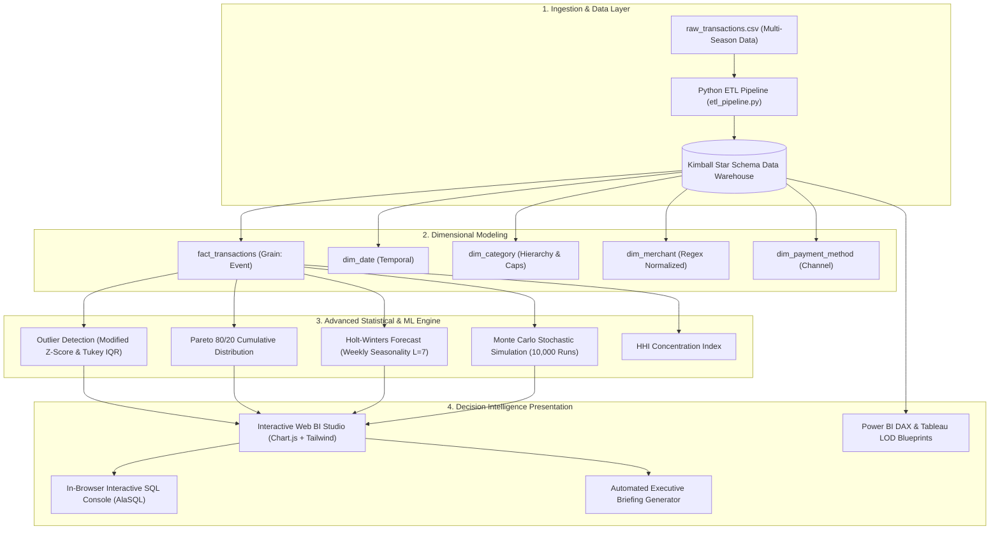

# 📊 FinancePulse — Financial Analytics & Predictive Intelligence Studio

[](LICENSE)
[](sql/star_schema_ddl.sql)
[](python_analytics/)
[](js/sql_studio.js)
[](bi_dashboard/)

An enterprise-grade, portfolio-ready financial analytics and decision intelligence platform engineered for **Data Analysts**, **BI Engineers**, and **Quantitative Financial Analysts**.

Built with an end-to-end analytical stack: **Kimball Star Schema**, **In-Browser OLAP SQL Studio**, **Statistical Anomaly Detection (Modified Z-Score & IQR)**, **Holt-Winters Time-Series Forecasting**, and **Monte Carlo Stochastic Risk Simulation**.

---

## 🏛️ System Architecture



---

## ✨ Core Analytical Features

### 1. 📊 Executive BI Dashboard & KPI Scorecards
- **Net Operating Cash Flow & Savings Margin %**: Live calculation of savings velocity against monthly inflow.
- **Daily Burn Rate & Cash Runway**: Projects operational cash runway in months using rolling moving averages.
- **Herfindahl-Hirschman Index (HHI)**: Quantifies portfolio spending concentration risk across essential and discretionary categories.
- **Budget Variance Monitoring**: Visual progress indicators tracking actual spend against budget allocations with warning triggers at 85% and 100%.

### 2. 🔍 Pareto 80/20 & Behavioral Deep-Dive
- **Dual-Axis Pareto Visual**: Sorts expenditure categories and vendors descending with a cumulative contribution line curve identifying the "Vital Few" cost drivers responsible for 80% of outflow.
- **Day-of-Week Behavioral Elasticity**: Analyzes weekend vs. weekday spending spikes to uncover impulse spending patterns.

### 3. 🚨 Statistical Anomaly & Outlier Engine
- **Robust Modified Z-Score ($\text{MAD}$)**: Detects abnormal transaction spikes without vulnerability to mean distortion caused by right-skewed data.
- **Tukey's IQR Fences**: Dynamic bounding with adjustable sensitivity multiplier ($2.0\sigma$ to $4.5\sigma$).
- **Subscription Leakage & Creep Detection**: Algorithmic detection of periodic recurring transactions, calculating Annual Recurring Outflow (ARE).

### 4. 🔮 Predictive Forecasting & Monte Carlo Simulation
- **Holt-Winters Triple Exponential Smoothing**: Models level ($\alpha$), trend slope ($\beta$), and weekly seasonality ($\gamma$, $L=7$) to forecast 30/60/90-day expenditures with **95% Confidence Intervals**.
- **Monte Carlo Stochastic Simulation (1,000 to 10,000 Iterations)**: Log-normal bootstrapping simulating remaining calendar days to determine the **Probability of Budget Overrun (%)** and P10/P50/P90 cash balances.
- **What-If Sensitivity Simulator**: Interactive sliders modeling discretionary cutbacks (-20% dining, -15% shopping) and macroeconomic inflation (+5%).

### 5. 💻 In-Browser OLAP SQL Studio (Powered by AlaSQL)
- Embedded client-side SQL IDE executing live ANSI-SQL queries against the Star Schema tables.
- **6 Pre-Configured Analytical Query Presets**:
  - Month-over-Month spend variance using the `LAG()` window function.
  - Pareto cumulative spend share with window running totals.
  - Top 3 spending categories per month via `DENSE_RANK() OVER (PARTITION BY month)`.
  - Weekday vs. weekend spend disparity.
  - Recurring subscription creep and annualized run-rate.
  - Budget utilization and variance.
- Query performance benchmarking (latency in milliseconds), row count, and CSV export.

---

## 📁 Repository Directory Structure

```
expense-tracker/
├── index.html                      # Executive BI Dashboard & OLAP Studio
├── README.md                       # Comprehensive Project Documentation
├── CV_PROJECT_SHOWCASE.md          # Tailored Resume Points, Interview Q&A, LinkedIn Post
├── css/
│   └── styles.css                  # Custom Typography, Dark Mode & Print Stylesheets
├── js/
│   ├── storage.js                  # LocalStorage, 1-Year Realistic Dataset Synthesizer
│   ├── analytics_engine.js         # Statistical Algorithms (IQR, Z-Score, Holt-Winters, Monte Carlo, HHI)
│   ├── sql_studio.js               # In-Browser AlaSQL Engine & Query Presets
│   ├── charts.js                   # Chart.js Visualizations (Pareto, Forecast with CIs, Anomalies)
│   └── app.js                      # Application Controller & Event Orchestrator
├── data/
│   ├── raw_transactions.csv        # Multi-Month Realistic Analytical Dataset (150+ Rows)
│   ├── synthetic_generator.py      # Python Synthetic Data Generation Script
│   └── data_dictionary.md          # Comprehensive Data Dictionary & Formula Definitions
├── sql/
│   ├── star_schema_ddl.sql         # Kimball Star Schema DDL (PostgreSQL, Snowflake, SQLite)
│   └── analytical_queries.sql      # 15+ Advanced Analytical SQL Queries (CTEs, Window Functions)
├── python_analytics/
│   ├── etl_pipeline.py             # Production-grade ETL Pipeline to SQLite OLAP Warehouse
│   ├── statistical_eda.py          # Descriptive Stats, ANOVA, Skewness, Kurtosis, IQR
│   ├── time_series_forecast.py     # Holt-Winters Modeling & Confidence Intervals
│   └── monte_carlo_simulator.py    # Monte Carlo 10,000 Stochastic Risk Simulator
├── notebooks/
│   └── expense_analytics_deep_dive.ipynb # Jupyter Notebook Walkthrough
└── bi_dashboard/
    ├── POWER_BI_SPECIFICATION.md   # Power BI Data Model & DAX Measure Blueprint
    └── TABLEAU_SPECIFICATION.md    # Tableau LOD Calculations & Dashboard Specifications
```

---

## 🚀 Quick Start (Running the Platform)

### Option 1: Direct In-Browser Launch (Zero Installation Required)
The interactive platform runs entirely in modern browsers with CDN modules:
1. Navigate to:
   ```
   C:\Users\creat\.gemini\antigravity\scratch\expense-tracker\
   ```
2. Double-click **`index.html`** or right-click -> **"Open with Chrome / Edge / Firefox"**.
3. Explore the Executive KPIs, run live SQL queries in the SQL Studio tab, adjust anomaly sensitivity, or trigger Monte Carlo simulations!

### Option 2: Running the Python Data Pipelines (Optional)
If Python 3.8+ is installed on your environment:
```powershell
# 1. Run the ETL Pipeline to create the SQLite Data Warehouse
python python_analytics/etl_pipeline.py

# 2. Run the Statistical Exploratory Data Analysis
python python_analytics/statistical_eda.py

# 3. Generate Holt-Winters 14-Day Out-of-Sample Forecast
python python_analytics/time_series_forecast.py

# 4. Run the 10,000-Iteration Monte Carlo Simulation
python python_analytics/monte_carlo_simulator.py
```

---

## 💼 Adding This Project to Your CV

See **[`CV_PROJECT_SHOWCASE.md`](CV_PROJECT_SHOWCASE.md)** for:
- Pre-written, interview-tested CV bullet points in Google **XYZ formula** format.
- Tailored descriptions for **Data Analyst**, **BI Analyst**, **Financial Analyst**, and **Analytics Engineer**.
- Top 10 Technical Interview Questions with model answers.
- A ready-to-publish LinkedIn project showcase post.
